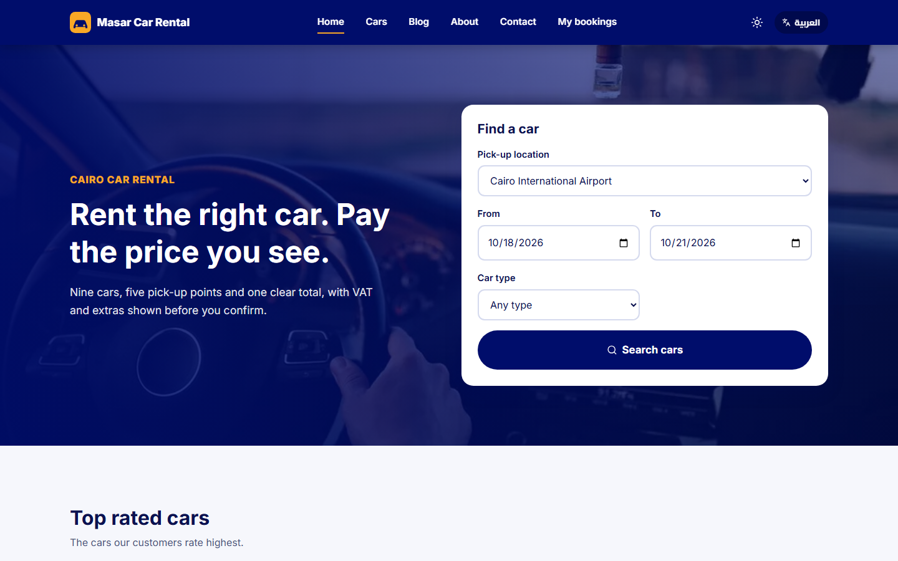
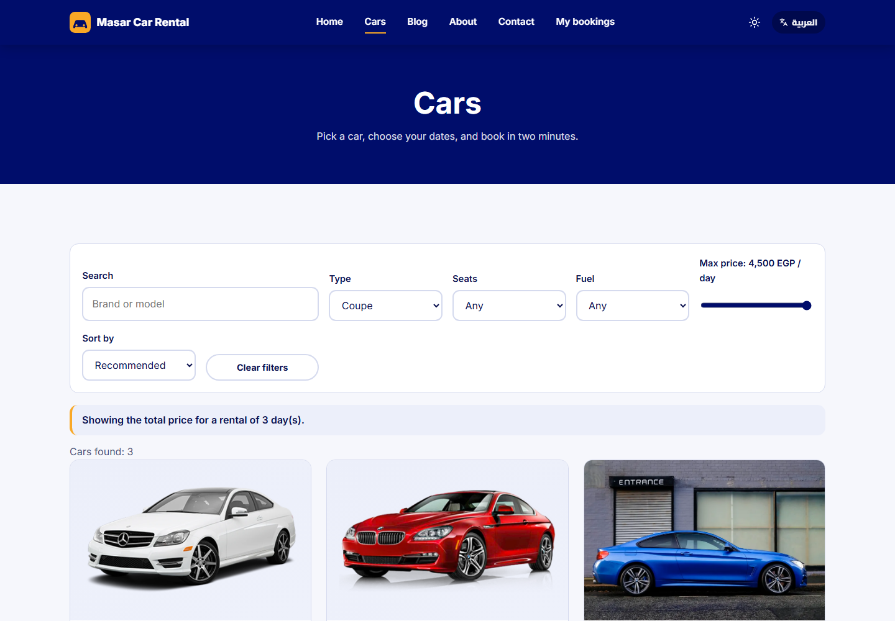
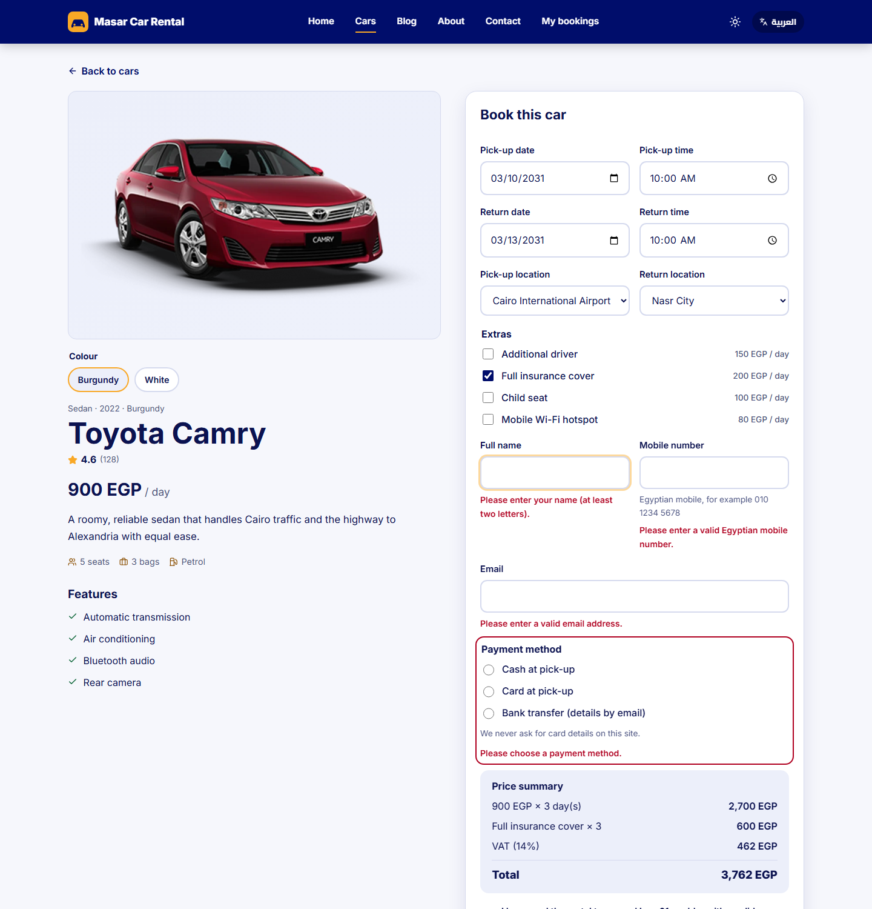
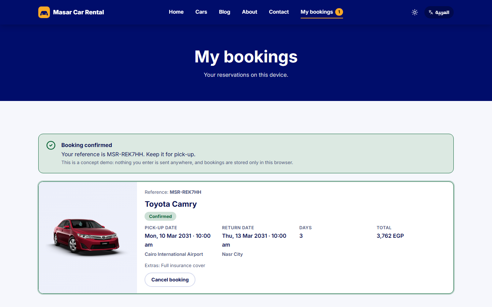
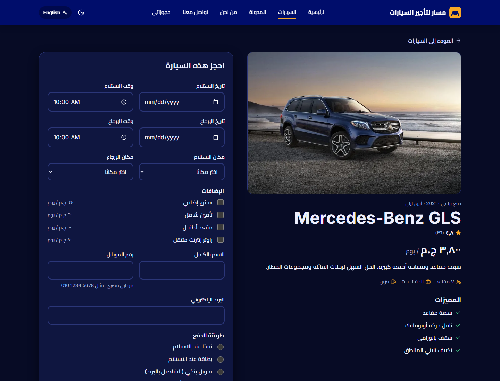
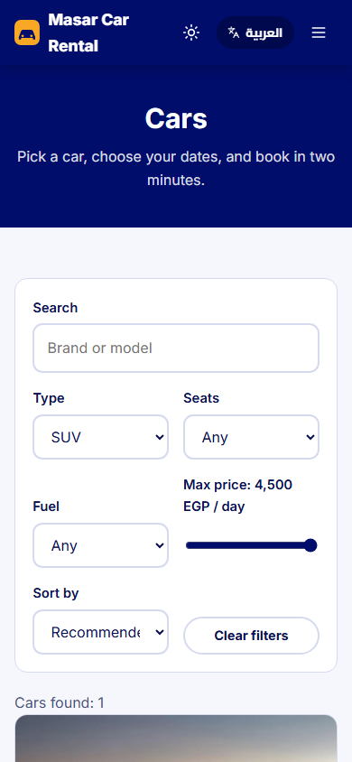

# Masar Car Rental

A bilingual (Arabic and English) car rental website for a fictional Cairo company. The point of the project is the **booking flow**: search a catalog, pick dates, see a live price breakdown, make a validated reservation, and manage it afterwards.

> **Concept project.** The business, prices, reviews and availability are fictional and the photos are stock images. No payment details are ever collected; bookings are stored only in your browser.
>
> **Live demo:** https://masar-car-rental.vercel.app



| Catalog with filters | Booking with a live price summary |
| --- | --- |
|  |  |

| My bookings | Arabic, dark theme, RTL | Phone |
| --- | --- | --- |
|  |  |  |

## What it does

- **Catalog of 9 cars** with real names that match their photos. Search, filter by type, seats, fuel and price, and sort; all of it lives in the URL, so a filtered view can be shared or refreshed. Colour swatches switch the car image.
- **Search from the home page** validates the dates and carries them to the catalog, where every card shows the **total for the whole stay**.
- **Booking page** with pick-up and return date and time, locations, extras, and a **live price breakdown** (days, extras, 14% VAT, total). Rentals are charged per started 24 hours, minimum one day, maximum 30 days.
- **Validation** on every field (Egyptian mobile numbers, Arabic digits accepted), past dates and reversed ranges rejected, focus moves to the first problem.
- **No double booking:** the same car cannot be reserved twice for overlapping dates; back-to-back is allowed; cancelling frees the dates.
- **My bookings:** confirmation with a reference, status, cancel with a confirmation dialog that tells you whether cancellation is still free (24 hours before pick-up). Persisted in `localStorage`, safe against corrupted data.
- **Arabic and English** with full RTL, localized numbers, prices (EGP, ج.م), dates and times; **light and dark** themes; both remembered and applied before first paint.
- Blog with three articles, FAQ accordion, review carousel, contact form, a real 404 (no more crash on an unknown car URL), and redirects for the old URLs.

## Tech

React 19 · Vite · React Router 7 · plain CSS with design tokens and logical properties · self-hosted fonts (Inter, Cairo) · native `<dialog>` · Vitest · Playwright · axe-core · ESLint 9. No UI framework.

The rules that matter are **pure functions** with their own tests: `lib/pricing.js` (dates, days, VAT, overlap, free-cancel window), `lib/filters.js` (search, filter, sort, safe URL parsing) and `lib/validate.js`. Content is data: every user-facing string is `{ en, ar }` or a key in `src/i18n`.

## Run it

```bash
npm install
npm run dev        # http://localhost:3003
npm run build
npm run preview
```

## Tests

```bash
npm run lint
npm test                 # unit tests
npx playwright install   # once
npm run test:e2e         # e2e and accessibility on Chromium, Firefox, WebKit and a phone viewport
npm run test:visual      # screenshot regression (Chromium; baselines are per platform)
```

- **Unit (32):** days and price maths (24 hour periods, VAT rounding, 30 day limit), overlap and cancellation window, catalog filters and sorting, hostile URL values, validation (Egyptian phone formats, Arabic digits), translation parity, **every translation key used in the code exists and none is unused**, and every content string exists in both languages.
- **End-to-end and accessibility (330+ runs):** every page and link, 404 and legacy redirects, the home search, all catalog filters and sorting, the full booking journey including exact totals, validation, overlap prevention, cancelling (free and late), persistence across reloads, corrupted storage, Arabic booking with Arabic digits, no horizontal scroll, and **axe-core on every page in both languages and themes**, plus error states, the cancel dialog, and a keyboard-only booking.
- Skipped on WebKit with a stated reason: Safari does not Tab to links by default.

## Quality numbers

Lighthouse on the production build, mobile (simulated slow 4G):

| Page | Performance | Accessibility | Best practices | SEO |
| --- | --- | --- | --- | --- |
| Home | 89 | 100 | 100 | 100 |
| Cars | 86 | 100 | 100 | 100 |
| Car detail | 93–95 | 100 | 100 | 100 |
| My bookings, About, Contact, Blog | 95–98 | 100 | 100 | 100 |

Desktop is 100 across the board on the home page. Images were converted to WebP: 2.3 MB became 0.6 MB.

## Structure

```
src/
  components/  Layout, ui (cards, FAQ, carousel, dialog, fields), FindCarForm
  pages/       Home, Cars, CarDetail (booking), Bookings, Blog, About, Contact, NotFound
  data/        cars, content (locations, extras, services, reviews, FAQ, posts), images
  lib/         pricing, filters, validate, dates (pure, unit tested)
  context/     settings (language, theme), bookings (state + localStorage)
  i18n/        en, ar
e2e/           Playwright specs
```

## History

The first version was a Create React App template with four UI libraries. The original is in the git history. The rebuild fixed: a white-screen crash on unknown car URLs, a booking form with no state or submit (and an email-typed "From address"), sort, search and contact forms that did nothing, unrelated photos and names, Lorem ipsum everywhere, 2.3 MB of images, and the move off an unmaintained toolchain, with zero `npm audit` vulnerabilities.
